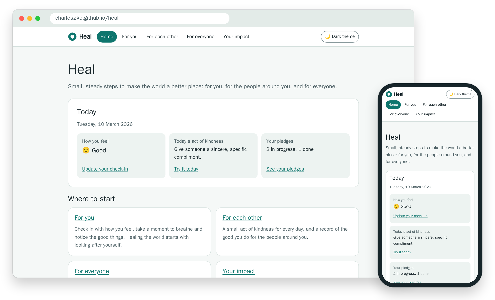
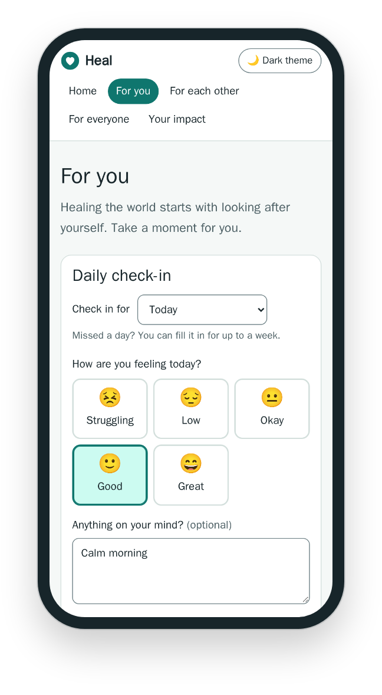
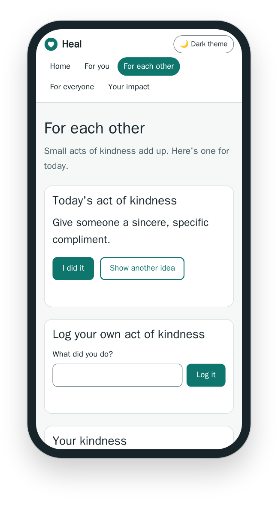
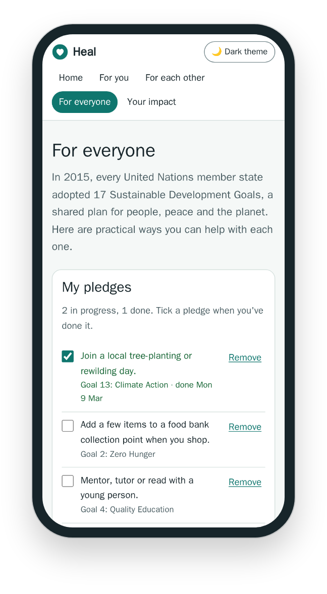
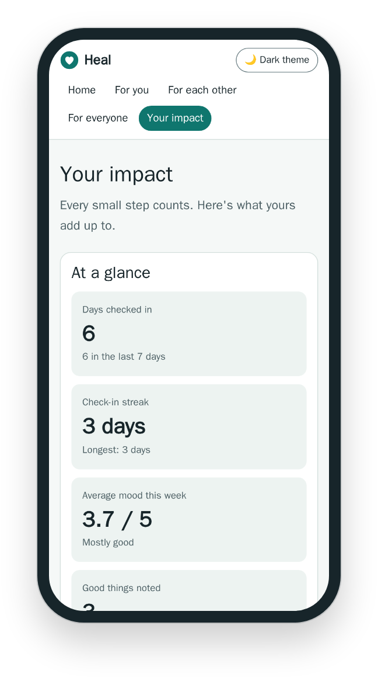

<p align="center">
  <a href="https://charles2ke.github.io/heal/"></a>
</p>

<h1 align="center">Heal</h1>

<p align="center">
  Heal the world, make it a better place, for you and me and the entire human race.
</p>

<p align="center">
  <a href="https://charles2ke.github.io/heal/"><strong>Open Heal at charles2ke.github.io/heal</strong></a>
  ·
  <a href="#use-it-as-an-app-and-offline">Install it</a>
  ·
  <a href="#run-it-locally">Run it locally</a>
</p>

<p align="center">
  <a href="https://github.com/charles2ke/heal/actions/workflows/ci.yml"></a>
  <a href="LICENSE"></a>
</p>

<p align="center">
  <a href="https://charles2ke.github.io/heal/">
    <picture>
      <source media="(prefers-color-scheme: dark)" srcset="docs/images/home-dark.png">
      
    </picture>
  </a>
</p>

Heal turns that mission into small, steady, private actions, in four feature sets:

| Feature set | Page | What you can do |
|---|---|---|
| **[For you](https://charles2ke.github.io/heal/you.html)** | `you.html` | Check in with your mood each day (or fill in a day you missed this week), note three good things and follow a guided breathing exercise, with four patterns and an optional timer. Low days point you to free support. |
| **[For each other](https://charles2ke.github.io/heal/together.html)** | `together.html` | Get an act-of-kindness idea each day, log your own kind acts and keep a streak going. |
| **[For everyone](https://charles2ke.github.io/heal/world.html)** | `world.html` | Browse practical actions for the 17 UN Global Goals, search and filter them, pledge the ones you'll do and mark them done. |
| **[Your impact](https://charles2ke.github.io/heal/impact.html)** | `impact.html` | See what your small steps add up to, with your streaks, and look back at any day or month on a calendar. Export your data or a spreadsheet copy, import a file to combine with or replace what's there, or delete it all. |

<table>
  <tr>
    <td align="center" width="25%">
      <a href="https://charles2ke.github.io/heal/you.html">
        <picture>
          <source media="(prefers-color-scheme: dark)" srcset="docs/images/you-dark.png">
          
        </picture>
      </a>
      <br><strong>For you</strong>
    </td>
    <td align="center" width="25%">
      <a href="https://charles2ke.github.io/heal/together.html">
        <picture>
          <source media="(prefers-color-scheme: dark)" srcset="docs/images/together-dark.png">
          
        </picture>
      </a>
      <br><strong>For each other</strong>
    </td>
    <td align="center" width="25%">
      <a href="https://charles2ke.github.io/heal/world.html">
        <picture>
          <source media="(prefers-color-scheme: dark)" srcset="docs/images/world-dark.png">
          
        </picture>
      </a>
      <br><strong>For everyone</strong>
    </td>
    <td align="center" width="25%">
      <a href="https://charles2ke.github.io/heal/impact.html">
        <picture>
          <source media="(prefers-color-scheme: dark)" srcset="docs/images/impact-dark.png">
          
        </picture>
      </a>
      <br><strong>Your impact</strong>
    </td>
  </tr>
</table>

## Privacy

Heal has no accounts, no analytics and no tracking. Everything stays in your browser's local storage, and you can export or delete it at any time from **Your impact**.

Heal is a self-care companion, not a medical or crisis service. If you or someone else is in immediate danger, call your local emergency number.

## Use it as an app, and offline

Heal can be installed from the browser, on a phone or a computer: open [charles2ke.github.io/heal](https://charles2ke.github.io/heal/), then use the **Install Heal** button on the home page where the browser offers one, or **Install** / **Add to Home Screen** in the browser's menu. After your first visit, a service worker (`sw.js`) keeps a copy of Heal in the browser, so every page works offline; the home page says when it's ready. It only stores Heal's own pages, scripts and styles, and can't see your data.

On an iPhone or iPad, and for web apps added from Safari on a Mac, the installed app keeps its own data, separate from the browser's. To bring your data across, export it from **Your impact** in the browser and import it in the app.

## Use it on more than one device

Your data never leaves the device, so nothing syncs by itself. To bring two devices together, export your data on one and import it on the other, choosing **Combine with my data**. Heal keeps everything that's already there and adds what's new, without duplicates and within Heal's usual limits, such as three good things a day. If both devices have a check-in for the same day, the one already there is kept. The spreadsheet (CSV) export is for reading or charting, and can't be imported.

## Run it locally

Heal is a static site with no build step. Serve the folder over HTTP (browsers won't load its JavaScript modules from `file://`):

```sh
npm start   # needs Python 3; serves http://127.0.0.1:4173
```

## Test it

```sh
npm ci
npx playwright install chromium   # first time only
npm test                          # unit tests (Node's built-in test runner)
npm run test:e2e                  # Playwright tests on desktop Chrome and Pixel 7
```

The Playwright run starts its own server and saves full-page screenshots of every page, in light and dark themes, to `screenshots/`. On each pull request, CI runs both test suites and comments with links to the screenshots and the Playwright report.

## Change it

After adding, removing or changing a page or anything under `assets/`, update the service worker's list of files and its version, so browsers fetch the new copy:

```sh
npm run sw:version
```

The unit tests fail if you forget. If you change `assets/icon.svg`, run `npm run icons` to redraw the app icons in `assets/icons/`, then `npm run sw:version`.

If you change how a page looks, retake the pictures in this README, in `docs/images/`:

```sh
npm run readme:screenshots
```

GitHub Pages publishes Heal from the `main` branch, at [charles2ke.github.io/heal](https://charles2ke.github.io/heal/), so changes go live soon after they're merged.

## Licence

[GNU AGPL v3.0](LICENSE)
